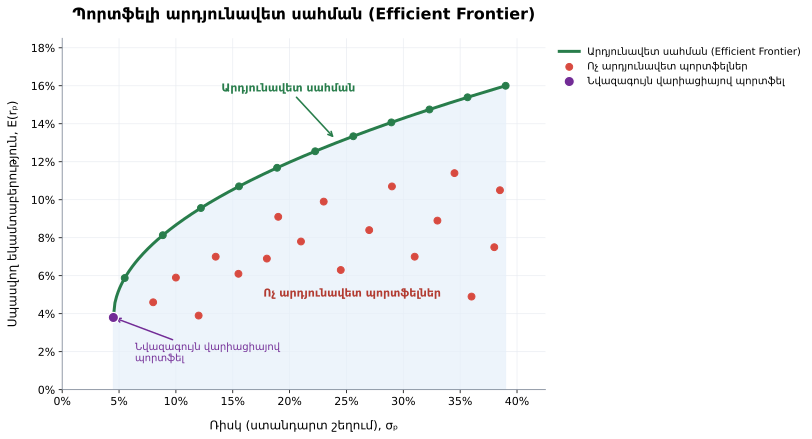

# Մարկովիցի Միջին-վարիացիոն Պորտֆելի Տեսություն

Ներդրումային գործունեության կարևորագույն խնդիրներից մեկը կապիտալի արդյունավետ բաշխումն է տարբեր ֆինանսական ակտիվների միջև։ Ներդրումային գործիքը, որը կարող է գնվել և վաճառվել, հաճախ անվանում են ակտիվ։ Ներդրողները ձգտում են ձևավորել այնպիսի պորտֆել, որը կապահովի առավելագույն եկամտաբերություն՝ միաժամանակ պահպանելով ռիսկի ընդունելի մակարդակ։

Բաժնետոմսերի պորտֆելը իրենից ներկայացնում է տարբեր ընկերությունների բաժնետոմսերի համախումբ, որտեղ յուրաքանչյուր ակտիվի ներդրման չափը որոշվում է համապատասխան կշռով։ Պորտֆելի կառուցման հիմնական նպատակը եկամտաբերության օպտիմալացումն է և ռիսկի նվազեցումը դիվերսիֆիկացիայի միջոցով։

Ժամանակակից պրակտիկայում կիրառվում են պորտֆելի օպտիմալացման բազմաթիվ մոդելներ։ Սակայն, որպես կանոն, դրանց մեծ մասը հիմնված է Մարկովիցի մոդելի վրա։ Նա առաջինն էր, ով 1951 թվականին առաջարկեց արժեթղթերի պորտֆելի օպտիմալ կառուցվածքի որոշման խնդրի մաթեմատիկական ձևակերպումը, ինչի համար հետագայում արժանացավ տնտեսագիտության ոլորտում Նոբելյան մրցանակի։ Մարկովիցի մոդելը հայտնի է որպես միջին-վարիացիոն (Mean-Variance) մոդել։ Այս մոդելը հիմնված է այն սկզբունքի վրա, որ ներդրողը ընտրում է պորտֆել՝ հաշվի առնելով երկու հիմնական ցուցանիշ՝ սպասվող եկամտաբերությունը և ռիսկը։

Ենթադրենք ներդրողը ցանկանում է իր կապիտալը ներդնել $n$ տարբեր ակտիվներում (օրինակ՝ բաժնետոմսերում)։ Յուրաքանչյուր ակտիվին հատկացվում է որոշակի բաժին, որը կոչվում է կշիռ և նշանակվում է $w_i$-ով, որտեղ $i = 1, 2, \ldots, n$։

Կշիռները ցույց են տալիս, թե ներդրողի ամբողջ կապիտալի որ մասն է ներդրված յուրաքանչյուր ակտիվում։ Օրինակ՝ եթե ներդրողը իր կապիտալի 30%-ը ներդնում է առաջին ակտիվում, ապա $w_1 = 0.3$։

Քանի որ ներդրողը բաշխում է իր ամբողջ կապիտալը, կշիռների գումարը պետք է հավասար լինի 1-ի․

$$
\sum_{i=1}^{n} w_i = 1
$$

Դիցուք $r_i$-ն $i$-րդ ակտիվի եկամտաբերությունն է։ Այն հաշվարկվում է հետևյալ ձևով․

$$
r_i = \frac{x_1 - x_0}{x_0}
$$

որտեղ՝  
- $x_0$ — ակտիվի սկզբնական (ձեռքբերման) գին  
- $x_1$ — ակտիվի վերջնական (վաճառքի) գին  

Եթե $r_i$-ն $i$-րդ ակտիվի եկամտաբերությունն է, ապա պորտֆելի ընդհանուր եկամտաբերությունը ներկայացվում է որպես կշռված գումար՝

$$
r_p = \sum_{i=1}^{n} w_i r_i
$$

Սա նշանակում է, որ պորտֆելի եկամտաբերությունը կախված է ինչպես ակտիվների եկամտաբերություններից, այնպես էլ դրանց կշիռներից։

Ֆինանսական շուկաներում ակտիվի գինը կարող է աճել, նվազել կամ մնալ գրեթե անփոփոխ՝ կախված շուկայի վիճակից, ընկերության ֆինանսական արդյունքներից, տնտեսական նորություններից, ներդրողների սպասումներից և այլ գործոններից։ Այդ պատճառով ակտիվի եկամտաբերությունը դիտարկվում է որպես պատահական մեծություն։

Քանի որ $r_i$-ն պատահական մեծություն է, դրա համար կարևոր է ոչ միայն մեկ կոնկրետ արժեքը, այլև դրա սպասվող արժեքը, այսինքն՝ միջինում ինչ եկամտաբերություն կարող է ապահովել այդ ակտիվը։ Ակտիվի սպասվող եկամտաբերությունը նշանակվում է՝

$$
E(r_i) = \mu_i
$$

որտեղ  
$\mu_i$-ն $i$-րդ ակտիվի սպասվող եկամտաբերությունն է։

Եթե պորտֆելը բաղկացած է $n$ ակտիվներից, և յուրաքանչյուր ակտիվի կշիռը պորտֆելում հավասար է $w_i$-ի, ապա պորտֆելի սպասվող եկամտաբերությունը հաշվարկվում է որպես ակտիվների սպասվող եկամտաբերությունների կշռված գումար՝

$$
E(r_p) = \sum_{i=1}^{n} w_i \mu_i
$$

Եթե բարձր եկամտաբերությամբ ակտիվի կշիռը մեծ է, ապա այն ավելի մեծ ազդեցություն կունենա ամբողջ պորտֆելի արդյունքի վրա։ Իսկ եթե տվյալ ակտիվի կշիռը փոքր է, ապա նրա ազդեցությունը պորտֆելի ընդհանուր եկամտաբերության վրա նույնպես փոքր կլինի։

Վեկտորային տեսքով պորտֆելի սպասվող եկամտաբերությունը ներկայացվում է՝

$$
E(r_p) = m^T w
$$

որտեղ

$$
m = (\mu_1, \mu_2, \ldots, \mu_n)^T
$$

ակտիվների սպասվող եկամտաբերությունների վեկտորն է, իսկ $w$-ն՝ պորտֆելի կշիռների վեկտորը։

Մարկովիցի մոդելում պորտֆելի ռիսկը չափվում է վարիացիայով։ Վարիացիան ցույց է տալիս, թե պորտֆելի եկամտաբերությունը որքանով է տատանվում իր սպասվող միջին արժեքի շուրջ։ Եթե եկամտաբերությունը շատ է տատանվում, ապա պորտֆելը համարվում է ավելի ռիսկային, իսկ եթե տատանումները փոքր են, ապա ռիսկը համեմատաբար ցածր է։

Առանձին ակտիվի դեպքում ռիսկը կարելի է գնահատել տվյալ ակտիվի եկամտաբերության վարիացիայով։ Սակայն պորտֆելի դեպքում միայն առանձին ակտիվների ռիսկերը հաշվելը բավարար չէ։ Պետք է հաշվի առնել նաև այն, թե այդ ակտիվները ինչպես են շարժվում միմյանց նկատմամբ։ Այսինքն՝ կարևորվում է ոչ միայն յուրաքանչյուր բաժնետոմսի անհատական տատանումը, այլև դրանց միջև փոխկապակցվածությունը։

Մարկովիցի մոդելում պորտֆելի վարիացիան հաշվարկվում է հետևյալ բանաձևով՝

$$
\sigma_p^2 = w^T \Sigma w
$$

որտեղ՝  

- $w$ — պորտֆելի կշիռների վեկտորն է, այսինքն՝ ցույց է տալիս, թե ընդհանուր կապիտալի որ մասն է ներդրված յուրաքանչյուր ակտիվում։  

- $\Sigma$ — ակտիվների եկամտաբերությունների կովարիացիոն մատրիցն է, որը ներառում է ինչպես առանձին ակտիվների վարիացիաները, այնպես էլ ակտիվների միջև կովարիացիաները։  

Կովարիացիոն մատրիցը ունի հետևյալ տեսքը՝

$$
\Sigma =
\begin{pmatrix}
\sigma_{11} & \sigma_{12} & \cdots & \sigma_{1n} \\
\sigma_{21} & \sigma_{22} & \cdots & \sigma_{2n} \\
\vdots & \vdots & \ddots & \vdots \\
\sigma_{n1} & \sigma_{n2} & \cdots & \sigma_{nn}
\end{pmatrix}
$$

Այստեղ գլխավոր անկյունագծի վրա գտնվող տարրերը՝ $\sigma_{11}$, $\sigma_{22}$, ..., $\sigma_{nn}$, ներկայացնում են առանձին ակտիվների վարիացիաները, այսինքն՝ դրանց անհատական ռիսկերը։ Իսկ անկյունագծից դուրս գտնվող տարրերը՝ $\sigma_{ij}$, ներկայացնում են $i$-րդ և $j$-րդ ակտիվների միջև կովարիացիաները։

Եթե երկու ակտիվների կովարիացիան դրական է, ապա դրանք սովորաբար շարժվում են նույն ուղղությամբ․ օրինակ՝ երկուսն էլ աճում են կամ երկուսն էլ նվազում են։ Այդ դեպքում պորտֆելի ընդհանուր ռիսկը կարող է բարձր լինել, քանի որ ակտիվները չեն փոխհատուցում միմյանց տատանումները։

Եթե կովարիացիան բացասական է, ապա ակտիվները հակառակ ուղղությամբ են շարժվում․ մեկի նվազումը կարող է ուղեկցվել մյուսի աճով։ Այդ դեպքում պորտֆելի ընդհանուր ռիսկը կարող է նվազել, քանի որ ակտիվները մասամբ փոխհատուցում են միմյանց։

Եթե կովարիացիան մոտ է զրոյի, ապա ակտիվների միջև ուժեղ կապ չկա, և դրանց շարժերը հիմնականում անկախ են։

Այս պատճառով Մարկովիցի մոդելում դիվերսիֆիկացիան հիմնվում է ոչ թե պարզապես շատ ակտիվներ ընտրելու, այլ այնպիսի ակտիվներ ընտրելու վրա, որոնց եկամտաբերությունները միմյանց հետ քիչ են կապված կամ հակադարձ կապ ունեն։

Մարկովիցի մոդելի հիմնական նպատակը պորտֆելի կշիռների ընտրությունն է այնպես, որ ապահովվի նվազագույն ռիսկ որոշակի եկամտաբերության դեպքում։

Այս խնդիրը ներկայացվում է որպես քառակուսային ծրագրավորման խնդիր․

$$
\min \frac{1}{2} w^T \Sigma w
$$

Օպտիմիզացիոն խնդիրը չի կարող լուծվել առանց սահմանափակումների, քանի որ պորտֆելի կշիռները պետք է բավարարեն ներդրումային որոշ պայմանների։

Առաջին սահմանափակումը վերաբերում է պահանջվող եկամտաբերությանը՝

$$
m^T w \ge \mu_b
$$

որտեղ $m$-ը ակտիվների սպասվող եկամտաբերությունների վեկտորն է, $w$-ն՝ պորտֆելի կշիռների վեկտորը, իսկ $\mu_b$-ն ներդրողի կողմից պահանջվող նվազագույն սպասվող եկամտաբերությունն է։

Երկրորդ սահմանափակումը բյուջեի սահմանափակումն է՝

$$
e^T w = 1
$$

Այստեղ $e$-ն միավոր վեկտոր է։ Այս պայմանը նշանակում է, որ բոլոր կշիռների գումարը պետք է հավասար լինի 1-ի։

Մարկովիցի պորտֆելի տեսության շրջանակներում կարևորագույն հասկացություններից մեկը նվազագույն վարիացիայով պորտֆելն է (minimum variance portfolio)։ Այս պորտֆելը այնպիսի ակտիվների համակցություն է, որը ապահովում է հնարավոր ամենացածր ռիսկը՝ անկախ սպասվող եկամտաբերության մակարդակից։

Այլ կերպ ասած, եթե ներդրողը ցանկանում է նվազագույնի հասցնել ռիսկը՝ առանց որևէ կոնկրետ եկամտաբերության պահանջի, ապա նա պետք է ընտրի հենց այս պորտֆելը։ Այսինքն այստեղ ունենք միայն

$$
e^T w = 1
$$

պայմանը։

Քանի որ խնդիրը ունի սահմանափակում, այն լուծելու համար կիրառվում է Լագրանժի բազմապատկիչների մեթոդը։ Այս մեթոդի գաղափարն այն է, որ սահմանափակումը մտցվում է նպատակային ֆունկցիայի մեջ՝ լրացուցիչ անդամի տեսքով։ Այդ նպատակով կազմվում է Լագրանժի ֆունկցիան․

$$
L(w, \lambda) = w^T \Sigma w - \lambda (e^T w - 1)
$$

որտեղ $\lambda$-ն կոչվում է Լագրանժի բազմապատկիչ։

Ածանցում ենք ըստ $w$-ի և հավասարեցնում 0-ի․

$$
\frac{\partial L}{\partial w} = 2 \Sigma w - \lambda e
$$

$$
2 \Sigma w - \lambda e = 0
$$

$$
\Sigma w = \frac{\lambda}{2} e
$$

$$
w = \frac{\lambda}{2} \Sigma^{-1} e
$$

Տեղադրում ենք $w$-ն

$$
e^T w = 1
$$

մեջ․

$$
e^T \left( \frac{\lambda}{2} \Sigma^{-1} e \right) = 1
$$

Այստեղից կստանանք, որ

$$
\frac{\lambda}{2} = \frac{1}{e^T \Sigma^{-1} e}
$$

Ստացվածը հետ տեղադրելով կստանանք՝

$$
w = \frac{\Sigma^{-1} e}{e^T \Sigma^{-1} e}
$$

## Արդյունավետ սահման

Եթե մենք տարբեր կշիռներով կառուցենք բազմաթիվ պորտֆելներ, ապա յուրաքանչյուր պորտֆել կարելի է պատկերել գրաֆիկի վրա՝ ըստ իր ռիսկի և եկամտաբերության։

Արդյունավետ է այն պորտֆելը, որը տվյալ ռիսկի մակարդակի համար տալիս է հնարավոր ամենաբարձր եկամտաբերությունը։

Օրինակ՝ եթե երկու պորտֆել ունեն նույն ռիսկը, բայց մեկը տալիս է 8% եկամտաբերություն, իսկ մյուսը՝ 10%, ապա 10% եկամտաբերությամբ պորտֆելն ավելի արդյունավետ է։

Նույն կերպ՝ եթե երկու պորտֆել ունեն նույն եկամտաբերությունը, բայց մեկը ունի ավելի փոքր ռիսկ, ապա փոքր ռիսկ ունեցող պորտֆելն է ավելի արդյունավետ։

Գրաֆիկում արդյունավետ սահմանից ներքև գտնվող պորտֆելները համարվում են ոչ արդյունավետ, որովհետև դրանց փոխարեն կարելի է ընտրել այլ պորտֆել, որը կամ նույն ռիսկով ավելի բարձր եկամտաբերություն է տալիս, կամ նույն եկամտաբերությամբ ավելի ցածր ռիսկ ունի։

Արդյունավետ սահմանը սկսվում է նվազագույն ռիսկի պորտֆելից՝

$$
w_{min-var}
$$

Այս կետը ունի հնարավոր ամենացածր ռիսկը բոլոր պորտֆելների մեջ։ Դրանից վերև գտնվող կորի հատվածն է համարվում արդյունավետ սահման։

Չնայած իր կարևորությանը, Մարկովիցի մոդելը ունի մի շարք սահմանափակումներ․

- կախված է մուտքային տվյալներից  
- ենթադրում է նորմալ բաշխում  
- դժվար է կիրառվում մեծ չափերի դեպքում  
- չի ներառում իրական շուկայի սահմանափակումներ  

Այս սահմանափակումները հանդիսանում են պատճառ, որ կիրառվեն ավելի ճկուն մեթոդներ, օրինակ՝ գենետիկ ալգորիթմներ։

## Գրականության ցանկ

- Burke J., *Markowitz Mean-Variance Portfolio Theory*, University of Washington  
  https://sites.math.washington.edu/~burke/crs/408/fin-proj/mark1.pdf
